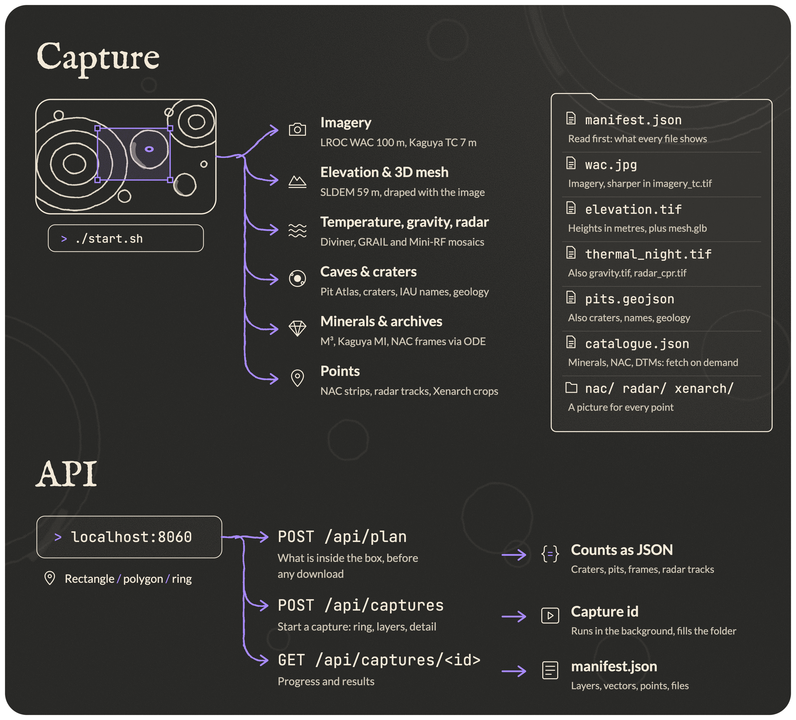

<p align="center">
  
</p>

<p align="center">
  Download a piece of the Moon<br>
  for you (<em>or your LLM</em>)
</p>

<p align="center">
  Cousin of <a href="https://github.com/Belluxx/Aleph">Aleph</a>, which does the same for the Earth.
</p>

Tav gives satellite imagery, terrain data, caves, minerals and on-site pictures of the Moon to your LLM.

- Draw a rectangle or polygon on the map of the Moon and Tav downloads **everything** inside it: imagery, elevation, a textured 3D mesh, night temperature, gravity, radar, craters, names, pits and geology.
- It also lists every archive product that crosses the box (high-resolution frames, mineral maps, stereo elevation models) and downloads the ones you ask for.

Aleph is the first letter of the Hebrew alphabet and Tav is the last. Like Aleph, Tav has no AI inside: it only collects data, so that a language model can look at a place.

<p align="center">
  
</p>

## Install

Requires Python 3 and `curl`. The only dependencies are numpy and Pillow. No API keys are required.

```sh
git clone https://github.com/Jules1052/tav.git
cd tav
./start.sh
```

The first run creates `.venv` and installs the dependencies. Tav then opens in your browser at `http://localhost:8060`. Set `PORT` to use another port.

## Open the map

Go to `http://localhost:8060/tav-app.html`. Draw a rectangle or polygon, choose the layers and the detail (512, 1,024 or 2,048 pixels on the longest side), then press Download. Open any capture to show or hide each layer, click a point to see its picture, or turn the 3D mesh.

Captures are saved in `captures/<id>/`. Read `manifest.json` first: it describes every file, its source, resolution and bounds.

| File | What it holds | Source |
| --- | --- | --- |
| `wac.jpg` | Imagery, 100 m per pixel | LROC WAC mosaic |
| `imagery_tc.tif`, `elevation_tc.tif` | Imagery and elevation, 7.4 m per pixel | Kaguya Terrain Camera |
| `elevation.tif`, `mesh.glb` | Heights in metres, and the image draped over them | SLDEM2015 (LOLA near the poles) |
| `thermal_night.tif` | Surface temperature at midnight | Diviner |
| `gravity.tif` | Free-air gravity anomaly | GRAIL |
| `radar_cpr.tif` | Radar circular polarisation ratio | Mini-RF |
| `pits.geojson`, `craters.geojson`, `names.geojson`, `geology.json` | Known pits, craters, IAU names, geologic units | Lunar Pit Atlas, Robbins crater database, Gazetteer, USGS |
| `catalogue.json` | Products that cross the box: NAC frames and stereo DTMs, Kaguya TC and MI mineral tiles, M³ cubes, Mini-RF strips | PDS Orbital Data Explorer |
| `nac/`, `radar/`, `xenarch/` | A picture for each point: NAC frames, Kaguya radar sounder tracks, crops of landing sites and hardware | LROC, Kaguya LRS, Xenarch |

Kaguya TC layers are built only from tiles already on disk, because each tile is a 302 MB download: tick “Sharper image and elevation” to fetch them. Xenarch pictures need a Hugging Face login (`huggingface-cli login` or `HF_TOKEN`).

## Use the API

The map talks to a local HTTP API, and an agent can use it directly. A box is a ring of `[latitude, longitude]` corners.

```sh
# What is inside the box, before any download
curl -X POST localhost:8060/api/plan \
  -d '{"ring": [[14.0, -56.9], [14.2, -56.9], [14.2, -56.7], [14.0, -56.7]]}'

# Start a capture; it answers with the capture id
curl -X POST localhost:8060/api/captures \
  -d '{"ring": [[14.0, -56.9], [14.2, -56.9], [14.2, -56.7], [14.0, -56.7]]}'

# Progress, then the full manifest
curl localhost:8060/api/captures/<id>
```

The example box is the Marius Hills pit. Add `"options": {"layers": [...], "max_px": 2048}` to a capture to choose the layers and the detail.

> [!NOTE]
> Data sources:
> - **LRO (LROC, LOLA, Diviner, Mini-RF), GRAIL, M³**: NASA Planetary Data System, served by [PDS Geosciences](https://pds-geosciences.wustl.edu), the [Orbital Data Explorer](https://ode.rsl.wustl.edu/moon/) and [Moon Trek](https://trek.nasa.gov/moon/).
> - **Kaguya (Terrain Camera, Multiband Imager, radar sounder)**: JAXA, through [DARTS](https://darts.isas.jaxa.jp/planet/pdap/selene/).
> - **Names, craters, pits, geology**: IAU Gazetteer, Robbins crater database, LROC Lunar Pit Atlas, USGS Unified Geologic Map of the Moon.
> - **Xenarch**: the [Xenarch dataset](https://huggingface.co/datasets/jules1235813/xenarch) on Hugging Face.
>
> Credit each source when you publish its data. Tav depends on these public servers, so it may break when they change.
